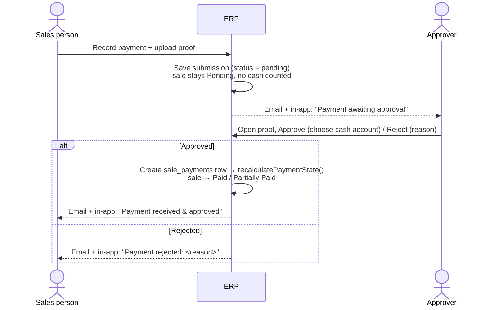

# Payment Proof & Approval — Implementation Plan

> Today any sales user can click **Record Payment** (or pick **Paid** on the sale form) and the
> money is instantly counted as received: the sale flips to *Paid*, and the amount flows into cash,
> the balance sheet, the dashboard and team performance. Nobody checks that the money actually
> arrived. This plan adds a **proof-of-payment upload** and a **role-managed approval step** with
> **email + in-app notifications** in both directions. Reviewed 2026-10-02.
>
> **Status: implemented** (phases 1 and 2, plus the shop-order customer email) — see §14 for the
> decisions taken and what differs from the plan below.

---

## 1. Target workflow

1. **Sales person** records a sale. If they say the customer has paid (fully or partly), the system
   **requires a proof upload** (MoMo screenshot, bank slip, card receipt, PDF) plus amount, method and
   transaction reference.
2. The payment is saved as a **submission — pending approval**. The sale is **not** marked Paid yet and
   the money is **not** counted anywhere in finance.
3. Every user allowed to **approve payments** gets an **email** and an **in-app notification** with a link
   to review it.
4. An **approver** opens the proof, checks it against the MoMo/bank account, and **approves** (optionally
   choosing which cash account received it) or **rejects** with a reason.
5. On approval the payment enters the real ledger, the sale's status is re-derived (*Paid* /
   *Partially Paid*), and the **sales person is notified** by email + in-app that the payment was received
   and approved. On rejection they are notified with the reason and can resubmit.

---

## 2. What exists today (and what it means for the design)

| Piece | Where | Implication |
|-------|-------|-------------|
| Payments ledger `sale_payments` | [SalePayment.php](../app/Models/SalePayment.php) | Has `recorded_by`, `cash_account_id`, `reference` — but **no status, no proof, no approver**. |
| Manual payment entry | [SalePaymentController.php:14](../app/Http/Controllers/Admin/SalePaymentController.php) | Writes straight to the ledger. Sales users can do it on their own sales. |
| "Paid" on sale form auto-creates a payment | [SaleWorkflowService.php:141](../app/Services/SaleWorkflowService.php) | Picking **Paid** silently records the whole balance as received. |
| Sale status derived from the ledger | [Sale.php:101](../app/Models/Sale.php) `recalculatePaymentState()` | ✅ Good: status can't be faked from the dropdown — it's always re-derived from ledger rows. We keep this. |
| Status audit trail | `sale_status_events` + [Sale.php:82](../app/Models/Sale.php) | Approval will produce a *Pending → Paid* event stamped with the **approver**. |
| Roles & gates | [User.php:17](../app/Models/User.php), [AppServiceProvider.php:19](../app/Providers/AppServiceProvider.php) | Fixed role→ability map; Owner gets everything via `Gate::before`. No per-user permissions yet. |
| Email | `Mail::to()->send()` in [StorefrontController.php:386](../app/Http/Controllers/StorefrontController.php), `EmailRoutingRule` | Sent **synchronously** with try/catch + logging. No queued jobs, no scheduler, no `notifications` table. Hosting looks like shared hosting (root `.htaccess` → `public/`). |
| Uploads | Product/employee/site images | All on the **`public`** disk — fine for images, **wrong for payment proofs** (they carry phone and account numbers). |

**Every finance consumer reads `sale_payments` as confirmed cash**, with no status filter:

- [CashFlowService.php:51](../app/Services/CashFlowService.php) — receipts from customers
- [BalanceSheetService.php:132](../app/Services/BalanceSheetService.php), [:234](../app/Services/BalanceSheetService.php), [:241](../app/Services/BalanceSheetService.php) — cash, prepayments, collections
- [AdminDashboardService.php:36](../app/Services/AdminDashboardService.php) — collections KPI
- [TeamPerformanceController.php:34](../app/Http/Controllers/Admin/TeamPerformanceController.php) — cash collected per person
- [CustomerController.php:87](../app/Http/Controllers/Admin/CustomerController.php), `CashAccount::payments()` — customer & account history

### Key design decision: keep unapproved money **out** of `sale_payments`

Rather than adding a `status` column to `sale_payments` (and then remembering to filter it in all seven
places above — and every future report), we add a separate **`sale_payment_submissions`** table. A
`sale_payments` row is created **only when a submission is approved**.

- `sale_payments` keeps meaning exactly what every report already assumes: *money confirmed received*.
- **Zero changes** to cash flow, balance sheet, dashboard, team performance or customer pages.
- **No backfill**: existing ledger rows are already "confirmed" (they simply have no proof attached).
- A report someone writes next year can't accidentally count pending or rejected money.

---

## 3. Data model

### 3.1 `sale_payment_submissions` (new)

| Column | Type | Notes |
|--------|------|-------|
| `id` | pk | |
| `sale_id` | FK sales, cascade | |
| `amount` | decimal(12,2) | > 0 |
| `method` | string | `SalePayment::METHODS` |
| `paid_at` | date | When the customer paid |
| `reference` | string, nullable | MoMo TX ID / bank ref — indexed for duplicate checks |
| `notes` | text, nullable | |
| `status` | string(20) | `pending` · `approved` · `rejected` · `withdrawn` · `reversed` (approved, then its ledger payment was removed) |
| `submitted_by` | FK users, nullOnDelete | The sales person |
| `reviewed_by` | FK users, nullable | Approver / rejecter |
| `reviewed_at` | timestamp, nullable | |
| `review_note` | text, nullable | **Required on reject** |
| `sale_payment_id` | FK sale_payments, nullable, nullOnDelete | Set on approval → link to the ledger row |
| timestamps | | Index `(status, created_at)`, `(sale_id, status)` |

### 3.2 `sale_payment_proofs` (new — 1–3 files per submission)

| Column | Type | Notes |
|--------|------|-------|
| `id`, `submission_id` (FK, cascade) | | |
| `disk`, `path` | string | Always the private `local` disk |
| `original_name`, `mime`, `size` | | For display / download headers |
| `sha256` | char(64), indexed | Detects the **same screenshot reused** on another payment |
| `uploaded_by` | FK users | |

### 3.3 `users.can_approve_payments` (new boolean, default `false`)

Migration sets it `true` for existing **Managers**. The Owner always passes via `Gate::before`.

### 3.4 `notifications` (Laravel standard table)

`php artisan make:notifications-table` — powers the in-app bell (`database` channel). `User` already
uses `Notifiable`.

### 3.5 Models

- `SalePaymentSubmission` — relations `sale`, `submitter`, `reviewer`, `proofs`, `payment`; scopes `pending()`;
  `STATUS_*` constants.
- `SalePaymentProof` — `submission`; `deleting` hook removes the file from disk.
- `Sale` — add `paymentSubmissions()`, `pendingSubmissions()`, accessor `pending_approval_amount`.
  `balance_due` stays ledger-based; add `submittable_balance` = total − approved − pending.
- `SalePayment` — add `submission()` (hasOne via `sale_payment_id`) so payment history can link to its proof.

---

## 4. Who can approve — role management

**New gate `approve-payments`** = Owner (always) **or** any active user with `can_approve_payments = true`.

- The Owner manages it from **Users → Edit**: a *"Can approve payments"* checkbox
  (`StoreUserRequest`/`UpdateUserRequest`, `admin/users/_form`). This gives "manage who approves"
  without building a full permission matrix, and lets the Owner nominate e.g. an accountant whatever
  their role.
- Defined alongside the role map in [AppServiceProvider.php](../app/Providers/AppServiceProvider.php) as a
  separate `Gate::define` (it's per-user, not per-role).
- **No self-approval:** `reviewer ≠ submitted_by` is enforced in the service, not just hidden in the UI.
- **Approvers' own submissions** (e.g. a Manager taking cash at the counter) are **auto-approved** at
  submit time — proof still stored, reviewer recorded as themselves. See open question Q2.
- Approvers can see and act on **all** sales' submissions (even if they lack `manage-all-sales`).

*(If you later want full role×permission editing, this gate is the first one to move into a table —
nothing in this plan blocks that.)*

---

## 5. Service layer — `PaymentSubmissionService`

All rules live in one place (new `app/Services/PaymentSubmissionService.php`), used by the controller,
the sale form workflow and tests.

**`submit(Sale, array $data, array $files, User $by)`**
1. Validate `amount ≤ sale.submittable_balance` (approved **and** pending count, so two pending
   submissions can't together exceed the invoice).
2. In a transaction: create the submission (`pending`), store each file on `local` at
   `payment-proofs/{Y}/{m}/{uuid}.{ext}` (never the client filename), compute `sha256`.
3. Write a timeline event (`sale_status_events`, `field = payment_review`, `to_status = submitted`).
4. If `$by` can approve → call `approve()` immediately (auto-approve path).
5. **After commit**: notify approvers (excluding `$by`).

**`approve(Submission, User $reviewer, ?int $cashAccountId)`**
1. Gate `approve-payments`; reviewer ≠ submitter.
2. Transaction + `lockForUpdate()` on the submission; abort unless still `pending` (stops double-click
   and two approvers racing).
3. Re-check `approved ledger + amount ≤ total_revenue` (the sale may have been edited down since).
4. Create the `SalePayment` (amount, method, paid_at, reference, notes, `cash_account_id`,
   **`recorded_by = submitter`** so team performance keeps crediting the sales person).
5. Mark submission `approved`, set `reviewed_by/at`, `sale_payment_id`.
6. `$sale->recalculatePaymentState()` → status changes and the existing `Sale::updated` hook logs
   *Pending → Paid* **by the approver**.
7. **After commit**: notify the submitter (and the sale creator, if different).

**`reject(Submission, User $reviewer, string $reason)`** — same guards; status `rejected`, reason
required (min 5 chars); sale untouched; notify submitter after commit.

**`withdraw(Submission, User $by)`** — submitter may cancel their own *pending* submission (typo).

---

## 6. Changes to existing flows

### 6.1 "Record a Payment" on the sale page
[SalePaymentController::store](../app/Http/Controllers/Admin/SalePaymentController.php) stops writing
to the ledger directly and calls `PaymentSubmissionService::submit()`.

- New validation: `proofs` **required**, `array|min:1|max:3`; each
  `file|mimes:jpg,jpeg,png,webp,pdf|max:5120` (5 MB). `reference` required for MoMo / Bank Transfer.
- Form gets `enctype="multipart/form-data"` and
  `<input type="file" name="proofs[]" accept="image/*,application/pdf" multiple>` — on phones this
  offers camera or gallery.
- Button label: **"Submit for approval"** (non-approvers) / **"Record payment"** (approvers).
- `destroy` (remove an *approved* ledger payment) stays `delete-records` only; it also flips the linked
  submission to `reversed` (keeping the proof and history) before deleting the ledger row.

### 6.2 Picking "Paid" on the sale create/edit form
[SaleWorkflowService::reconcileLedger](../app/Services/SaleWorkflowService.php) currently auto-creates
a ledger payment for the full balance. Change it to:

- When `payment_status = Paid` is chosen, the form reveals a **payment section**: amount (defaults to
  total, editable for part-payments), method, reference, **proof upload (required)**.
- `StoreSaleRequest` / `UpdateSaleRequest`: `proofs` → `required_if:payment_status,Paid` (skipped on
  edit if a pending submission already covers the balance).
- `reconcileLedger` calls `PaymentSubmissionService::submit()` instead of `SalePayment::create()`.
  The sale is saved as **Pending** with an **"Awaiting approval"** badge until approved.
- `sale/_form` and `create`/`edit` views get `enctype="multipart/form-data"`.
- Online Store checkout is unaffected (it always creates *Pending* sales; payments are recorded later
  through 6.1).

### 6.3 Status display
We **don't** add a new `payment_status` value (it's used by filters, badges and reports). Instead
"Awaiting approval" is derived from `pendingSubmissions` and shown as an extra badge next to the
payment badge (`x-admin.sale-status-badge`), plus a new **Awaiting approval** filter on the sales list.

---

## 7. Notifications

Three Laravel Notification classes, each with **`mail` + `database`** channels:

| Notification | To | Content |
|--------------|----|---------|
| `PaymentSubmittedNotification` | All active approvers except the submitter | Sale ref, customer, amount, method, reference, submitted by, **"Review payment"** button |
| `PaymentApprovedNotification` | Submitter (+ sale creator if different) | "Payment of X RWF for SALE-… was received and approved by …", new balance |
| `PaymentRejectedNotification` | Submitter | Reason, "Resubmit" link to the sale |

- **Delivery: synchronous, after commit**, one try/catch per recipient with `[mail] payment_*` log
  lines — the same pattern the storefront already uses. No `ShouldQueue` unless a queue worker is
  confirmed on the server (see Q4); queued mail on shared hosting without a worker silently never sends.
  An SMTP failure **never** blocks an approval.
- The **database channel is the safety net**: even if email fails, the bell shows it.
- **Proof files are linked, not attached** — emails get forwarded; the link requires login.
- Optional: add `payment_submitted` to `EmailRoutingController::EVENTS` so the Owner can also route
  copies to a shared finance inbox from the existing Email Routing screen.
- Optional: email the **customer** a receipt on approval when `customer_email` is set.

**In-app:** a bell with unread count in the admin layout
([components/layouts/admin.blade.php](../resources/views/components/layouts/admin.blade.php)), a small
`NotificationController` (index, mark-read, mark-all-read), and a **"Payments to approve (N)"** nav
item for approvers.

---

## 8. Proof file security

- Stored on the private **`local`** disk (`storage/app/private`) — **never** `public`.
- Served only through `GET /admin-app/payment-proofs/{proof}` (new `PaymentProofController@show`),
  authorized for: the submitter, the sale's creator, approvers, and `manage-all-sales` users. Returns
  `Storage::disk('local')->response()` inline for images/PDF with `X-Content-Type-Options: nosniff`.
  Everyone else gets 403.
- Validate by MIME + extension, cap size, and generate the stored filename server-side.
- **Fraud checks shown to the approver** (cheap, high value):
  - ⚠️ *"This exact file was already submitted on SALE-…"* (same `sha256`)
  - ⚠️ *"Reference MP2410… was already used on SALE-…"* (same `reference`, any status)
- Files are kept after rejection (audit trail). When a sale is deleted, delete its proof files too
  (`Sale` `deleting` hook) — DB cascades don't fire model events, so files would otherwise be orphaned.

---

## 9. Screens

| Screen | Who | What |
|--------|-----|------|
| **Sale page** ([sales/show.blade.php](../resources/views/admin/sales/show.blade.php)) | Everyone with access | Upload-enabled payment form; **Pending approval** panel listing submissions with proof thumbnails and status chips; approvers see **Approve** (with cash-account select) / **Reject** (reason) inline; payment history links each row to its proof; timeline shows submitted / approved / rejected with who and when. |
| **Payment Approvals** (`/admin-app/payment-approvals`, new) | `approve-payments` | Tabs *Pending / Approved / Rejected*; columns: age, sale, customer, amount, method, reference, submitted by, proof preview, fraud warnings; approve/reject actions. Oldest first. |
| **Sales list** | Everyone | "Awaiting approval" badge + filter. |
| **Users → Edit** | Owner | "Can approve payments" checkbox. |
| **Dashboard** | Approvers | KPI: *Awaiting approval: N · X RWF*. |
| **Bell / notifications** | Everyone | Unread list, mark read. |

Routes: approvals inside a new `can:approve-payments` group in
[routes/admin.php](../routes/admin.php); submit/withdraw stay inside the existing `can:record-sales` group.

---

## 10. Files to add / change

**New:** 3 migrations (submissions + proofs, `users.can_approve_payments`, notifications table) ·
`SalePaymentSubmission`, `SalePaymentProof` models · `PaymentSubmissionService` ·
`PaymentApprovalController`, `PaymentProofController`, `NotificationController` · 3 Notification classes +
mail views · `admin/payment-approvals/index.blade.php` · `tests/Feature/PaymentApprovalTest.php`.

**Changed:** `SalePaymentController`, `SaleWorkflowService::reconcileLedger`, `Store/UpdateSaleRequest`,
`Store/UpdateUserRequest`, `Sale`, `SalePayment`, `User` (`$fillable`, cast), `AppServiceProvider` (gate),
`routes/admin.php`, `sales/show`, `sales/_form`, `sales/create`, `sales/edit`, `sales/index`,
`users/_form`, admin layout (nav + bell), dashboard view, `docs/SYSTEM-MODULES.md`.

**Unchanged on purpose:** `CashFlowService`, `BalanceSheetService`, `AdminDashboardService` collections,
`TeamPerformanceController`, `CustomerController` — they keep reading the approved-only ledger.

---

## 11. Tests (`tests/Feature/PaymentApprovalTest.php`)

Using `Storage::fake('local')` and `Notification::fake()`:

1. Submitting without a proof file → validation error; nothing saved.
2. A pending submission leaves `amount_paid`, `payment_status`, cash flow and balance-sheet cash unchanged.
3. Approvers (Owner + flagged Manager) are notified; an unflagged Manager and the submitter are not.
4. A sales user can't approve (403); a submitter can't approve their own submission.
5. Approve → ledger row created with `recorded_by = submitter`, sale becomes *Paid*, status event
   stamped with the approver, submitter notified.
6. Reject requires a reason; sale unchanged; submitter notified with the reason; resubmission works.
7. Approving an already-approved submission is refused (race/double-click).
8. Pending + approved can't exceed the invoice total; approval re-checks after the sale is edited down.
9. Proof download: another sales user → 403; approver → 200; file is on `local`, not `public`.
10. Same file / same reference on two submissions → duplicate warnings.
11. A throwing mailer doesn't roll back an approval (and is logged).
12. Approver-submitted payment is auto-approved with proof stored.
13. Picking *Paid* on the sale form without a proof → validation error; with a proof → pending submission, sale *Pending*.

---

## 12. Rollout phases

**Phase 1 — core (ship first):** migrations, models, `PaymentSubmissionService`, `approve-payments`
gate + Users checkbox, proof upload on the sale page, approve/reject on the sale page, email + database
notifications, proof download route, tests 1–12.

**Phase 2 — workflow polish:** "Paid" on create/edit form requires proof (6.2, test 13), Payment
Approvals queue page, nav count + bell, sales-list badge/filter, dashboard KPI, duplicate warnings UI.

**Phase 3 — optional:** reminder emails for submissions pending > 24 h (needs a server cron running
`php artisan schedule:run` every minute), finance-inbox routing via Email Routing, customer receipt
email, SMS/WhatsApp notifications.

**Deployment notes:** run migrations; `MAIL_MAILER` must be real SMTP in production (`.env.example`
defaults to `log`); confirm at least one approver besides the Owner is ticked.

---

## 13. Open questions (need a decision before Phase 1)

| # | Question | Recommendation |
|---|----------|----------------|
| Q1 | **Cash at the counter** has no screenshot. Require a proof (photo of signed receipt) for Cash too? | Require proof for MoMo / Bank / Card; **optional for Cash**, but Cash still needs approval. |
| Q2 | Payments recorded **by an approver** — auto-approve, or always need a second person? | Auto-approve (small team); revisit if you want strict two-person control. |
| Q3 | Default approvers? | Owner + all current Managers (migration ticks Managers). |
| Q4 | Is a **queue worker** running on the production server? | If not (likely on shared hosting), send mail synchronously as above. |
| Q5 | Notify the **customer** on approval? | Yes when `customer_email` is set — Phase 3. |

---

## 14. Decisions taken & implementation notes (2026-10-02)

| # | Decision |
|---|----------|
| Q1 | Proof **required** for MoMo, Bank Transfer, Card and Other; **optional for Cash**. Every payment, cash included, still needs approval. Reference required for MoMo and Bank Transfer. |
| Q2 | Payments reported by someone who can approve are **approved immediately**; proof is still stored and they are recorded as the reviewer. |
| Q3 | Approvers are the **Owner + every Manager** (migration ticks existing managers); the Owner changes this per user on Users → Edit. |
| Q4 | **Synchronous mail after commit**, no queue. The in-app (`database`) copy is written before the email. |
| Q5 | Customers get **no email** for payment approval, **except Online Store orders**: the customer receives *"Payment received — your order is being processed"* (`OnlineOrderPaymentReceivedMail`). |

**What shipped:** migrations `2026_10_02_000001…000003`; `SalePaymentSubmission`, `SalePaymentProof`;
`PaymentSubmissionService`; `approve-payments` gate; `PaymentApprovalController`, `PaymentProofController`,
`NotificationController`; three notifications + the customer mailable; Payment Approvals queue and review
page, sale-page reporting / review / timeline, sale-form proof section, sales-list badge and filter,
dashboard alert, nav count and notification bell; `tests/Feature/PaymentApprovalTest.php` (21 tests).

**Differences from the plan:**
- No separate timeline rows are written to `sale_status_events` for reports; the sale timeline merges the
  submissions' own timestamps instead (the *Pending → Paid* status event is still logged by the approver).
- On the sale form, *Paid* reports the **whole open balance** (part-payments stay on the sale page), and the
  method comes from the sales channel.
- Not built (Phase 3): reminder emails for stale reports (needs a cron for `schedule:run`), a finance-inbox
  routing rule, SMS/WhatsApp.

**Deploying:** run `php artisan migrate`, rebuild assets (`npm run build`), set real SMTP (`MAIL_MAILER`),
and keep `storage/app/private` persistent between deploys — the proof files live there.

