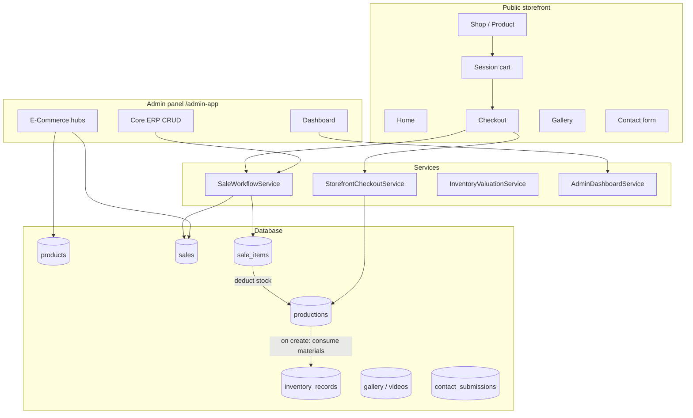
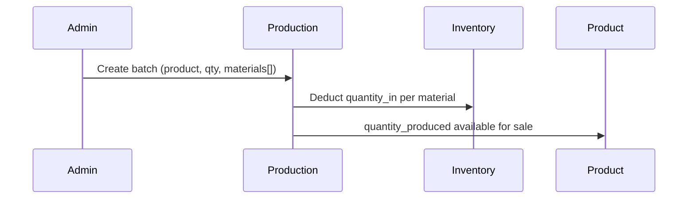
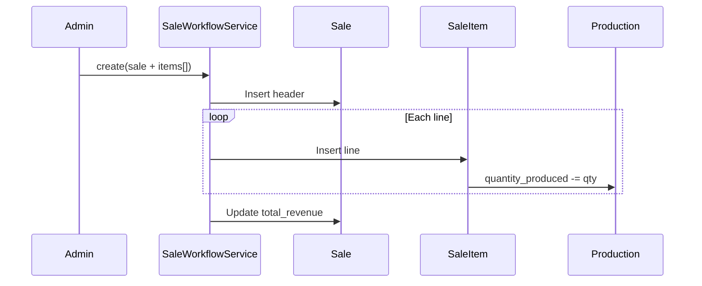
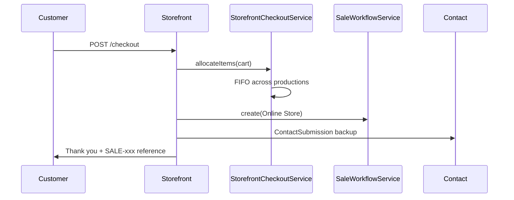

# SHAKY Ltd — System & Module Documentation

This document describes how the **SHAKY Ltd** application works end-to-end: architecture, data model, business workflows, and every admin and storefront module.

**Stack:** Laravel 12 · PHP 8.2+ · Blade · Vite · Tailwind CSS 4 · MySQL (or SQLite in development)

**Admin URL prefix:** `/admin-app`  
**Public storefront:** site root (`/`)

---

## Table of contents

1. [System overview](#1-system-overview)
2. [Architecture diagram](#2-architecture-diagram)
3. [Data model](#3-data-model)
4. [Core services](#4-core-services)
5. [Authentication & access](#5-authentication--access)
6. [Public storefront modules](#6-public-storefront-modules)
7. [Core ERP admin modules](#7-core-erp-admin-modules)
8. [E-Commerce admin hub](#8-e-commerce-admin-hub)
9. [Business workflows](#9-business-workflows)
10. [Configuration & storage](#10-configuration--storage)
11. [File map (quick reference)](#11-file-map-quick-reference)

---

## 1. System overview

SHAKY Ltd is a **single-database ERP + e-commerce** application for a chili products business in Rwanda (Neza sauces, chili oil, etc.).

| Layer | Role |
|--------|------|
| **ERP (Core admin)** | Source of truth: products, raw inventory, production batches, sales, employees, users, reports |
| **Storefront** | Public website: shop, cart, checkout, gallery, contact |
| **E-Commerce admin** | Operational views and light CMS on top of ERP data (orders, stock sync, gallery, videos) |

**Important design rule:** The website does **not** use a separate `orders` table. Online checkout creates the same `sales` and `sale_items` records as the admin sales module, with `sales_channel = "Online Store"`.

---

## 2. Architecture diagram



---

## 3. Data model

### 3.1 Entities

| Model | Table | Purpose |
|--------|--------|---------|
| `User` | `users` | Admin login accounts |
| `Employee` | `employees` | Staff records (production attribution) |
| `Product` | `products` | Sellable SKU: name, `type` (category), price, image, barcode |
| `InventoryRecord` | `inventory_records` | Raw material stock IN/OUT, supplier payments, unit cost |
| `Production` | `productions` | Finished-goods **batch** per product; `quantity_produced` = sellable units |
| `Sale` | `sales` | Sale / order header (customer, channel, payment, delivery, totals) |
| `SaleItem` | `sale_items` | Line items: product, production batch, qty, price |
| `ContactSubmission` | `contact_submissions` | Contact form + backup copy of website orders |
| `StorefrontVideo` | `storefront_videos` | Homepage videos |
| `StorefrontGalleryAlbum` | `storefront_gallery_albums` | Photo albums |
| `StorefrontGalleryPhoto` | `storefront_gallery_photos` | Photos in albums |

### 3.2 Relationships

```
Product 1──* Production
Product 1──* SaleItem
Production 1──* SaleItem
Sale 1──* SaleItem
Employee 1──* Production
StorefrontGalleryAlbum 1──* StorefrontGalleryPhoto
```

### 3.3 Stock logic (critical)

| Concept | Where it lives | How it changes |
|---------|----------------|----------------|
| **Raw materials** | `inventory_records.quantity_in` / `quantity_out` | **In** = received; **Out** increases when **Production** uses materials (`quantity_in − quantity_out` = on hand) |
| **Finished goods (sellable)** | `productions.quantity_produced` per batch | Increased by production; **reduced when a `SaleItem` is created** |
| **Storefront “in stock”** | Sum of `quantity_produced` on `catalogQuery()` | Not raw inventory |

There is **no** separate warehouse table for finished goods—batches in `productions` are the stock pool.

### 3.4 Sale header fields (website orders)

| Field | Website checkout usage |
|--------|-------------------------|
| `customer_name` | Full name from form |
| `customer_Phone` | Phone |
| `barcode` | **Customer email** (legacy field name) |
| `invoice_number` | Delivery address + optional notes |
| `sales_channel` | Always `"Online Store"` |
| `payment_status` | `"Pending"` |
| `delivery_status` | `"Pending"` |
| `sales_id` | Auto-generated reference, e.g. `SALE-20260603145757-848` |

---

## 4. Core services

| Service | File | Responsibility |
|---------|------|----------------|
| **SaleWorkflowService** | `app/Services/SaleWorkflowService.php` | Creates/updates `Sale` + `SaleItem` in a DB transaction; recalculates `total_revenue`; on update, restores old production qty before rebuilding lines |
| **StorefrontCheckoutService** | `app/Services/StorefrontCheckoutService.php` | Validates cart qty vs `sellable_qty`; allocates lines across production batches (FIFO by production `id`) |
| **AdminDashboardService** | `app/Services/AdminDashboardService.php` | Dashboard KPIs, charts, recent website orders |
| **InventoryValuationService** | `app/Services/InventoryValuationService.php` | FIFO valuation, COGS, gross profit for reports |

---

## 5. Authentication & access

| Item | Detail |
|------|--------|
| Login URL | `GET/POST /admin-app/login` |
| Guard | Laravel `web` session, model `App\Models\User` |
| Protected routes | Middleware `admin.session` → `App\Http\Middleware\EnsureAdminSession` |
| Behavior | Unauthenticated users redirect to `admin.login` |
| Storefront | No customer login; cart/wishlist use **session** keys only |

**Session keys (storefront):**

- `storefront_cart` — `{ product_id: quantity }`
- `storefront_wishlist` — list of product IDs
- `storefront_last_order_id` — last placed sale (thank-you page)

---

## 6. Public storefront modules

**Controller:** `app/Http/Controllers/StorefrontController.php`  
**Layout:** `resources/views/components/layouts/storefront.blade.php`

### 6.1 Home (`GET /`)

| Input | Behavior |
|--------|----------|
| Products | Best sellers from `SaleItem` aggregates (top 6 by units sold) |
| Videos | Active `StorefrontVideo` rows, ordered by `sort_order` |
| Gallery | Up to 6 active albums with photos; fallback static images if DB empty |
| Sections | Hero, mission/vision, why SHAKY, best sellers, videos, gallery, testimonials, partners, CTA |

### 6.2 Shop (`GET /shop`)

- Lists products via `catalogQuery()` (includes `sellable_qty` from production totals).
- Filters: search, category (`products.type`), price min/max, sort (name, newest, popular, price).
- Layout: grid or list.

### 6.3 Product detail (`GET /shop/{product}`)

- Product from catalog query (stock-aware).
- Related products: same `type`.
- Reviews: derived from past `SaleItem` data (display only).

### 6.4 Cart (`GET /cart`, `POST/PATCH /cart/{product}`)

| Action | Route | Effect |
|--------|-------|--------|
| View cart | `GET /cart` | Hydrates session cart with product rows and subtotal |
| Add | `POST /cart/{product}` | Increments quantity in session |
| Update/remove | `PATCH /cart/{product}` | Set qty; `0` removes line |

### 6.5 Checkout (`GET /checkout`, `POST /checkout`)

**Flow:**

1. Validate name, email, phone, address, optional notes.
2. Load cart from session; reject if empty.
3. `StorefrontCheckoutService::allocateItems()` — stock check + FIFO batch split.
4. `SaleWorkflowService::create()` — ERP sale with channel **Online Store**.
5. Create `ContactSubmission` (subject: `Website order {sales_id}`).
6. Clear cart; store `storefront_last_order_id`.
7. Redirect to thank-you page with success message.

**Failure cases:** insufficient stock, allocation error, DB exception (shown on checkout form).

### 6.6 Thank you (`GET /checkout/thank-you`)

Shows order reference, customer, total, payment/delivery status.

### 6.7 Gallery (`GET /gallery`, `GET /gallery/{album}`)

- Index: all active albums with cover image and photo count.
- Album: all active photos in that album.

### 6.8 Wishlist (`GET /wishlist`, `POST /wishlist/{product}`)

Session list of product IDs; no checkout integration.

### 6.9 Contact (`GET/POST /contact`)

Saves `ContactSubmission` (name, email, phone, subject, message). Newsletter in footer uses same endpoint with hidden preset fields.

### 6.10 About (`GET /about`)

Static marketing page.

---

## 7. Core ERP admin modules

**Base path:** `/admin-app` · **Auth required**

### 7.1 Dashboard

| Route | Controller | Operation |
|-------|------------|-----------|
| `GET /admin-app/` | `DashboardController` | KPIs (employees, products, production, inventory value, revenue, profit, pending payments), charts, **recent website orders** table |

Data from `AdminDashboardService` + `InventoryValuationService`.

### 7.2 Products

| Route | Controller | Operation |
|-------|------------|-----------|
| `admin.products.*` | `ProductController` | Full CRUD: name, type/category, price, compare-at price, barcode, description, image upload to `storage/` |

Products are the **master catalog** used by production, sales, and storefront.

### 7.3 Inventory records

| Route | Controller | Operation |
|-------|------------|-----------|
| `admin.inventory-records.*` | `InventoryRecordController` | CRUD for raw material layers: quantities in/out, unit cost, supplier, payment status (Paid/Partial/Unpaid) |

Used as input stock for **production** (materials consumed on production create).

### 7.4 Productions

| Route | Controller | Operation |
|-------|------------|-----------|
| `admin.productions.*` | `ProductionController` | CRUD for batches: product, employee, `quantity_produced`, materials JSON, batch id, production date |

**On create:** validates and deducts raw materials from `inventory_records`; increases sellable pool for the product.

### 7.5 Sales

| Route | Controller | Operation |
|-------|------------|-----------|
| `admin.sales.*` | `SaleController` | Full CRUD via `SaleWorkflowService` + `StoreSaleRequest` / `UpdateSaleRequest` |

- Multi-line items (product + production batch + qty + unit price).
- **This is where website orders appear** — filter/search by customer, sale ID, email (`barcode`), channel.
- Payment/delivery shown as **color badges** (`x-admin.sale-status-badge`); an extra **awaiting approval** badge (and list filter) marks sales with a reported payment not yet reviewed.
- Payments are **reported with proof** and only count once approved — see [9.6](#96-payment-proof--approval).

| Route | Controller | Operation |
|-------|------------|-----------|
| `POST admin.sales.payments.store` | `SalePaymentController` | Report a payment with proof (approvers: recorded at once) |
| `DELETE admin.sales.payment-submissions.withdraw` | `SalePaymentController` | Submitter withdraws their own pending report |
| `admin.payment-approvals.*` | `PaymentApprovalController` | Approver queue, review page, approve / reject (`can:approve-payments`) |
| `GET admin.payment-proofs.show` | `PaymentProofController` | Streams a proof file from the private disk to people involved |
| `admin.notifications.*` | `NotificationController` | In-app notifications (bell in the top bar) |

### 7.6 Employees

| Route | Controller | Operation |
|-------|------------|-----------|
| `admin.employees.*` | `EmployeeController` | Staff CRUD (linked to production records) |

### 7.7 Users

| Route | Controller | Operation |
|-------|------------|-----------|
| `admin.users.*` | `UserController` | Admin account CRUD (login credentials) |

### 7.8 Reports

| Route | Controller | Operation |
|-------|------------|-----------|
| `GET /admin-app/reports` | `ReportController` | Period filters, sales by product, inventory snapshot, reuses dashboard analytics |

### 7.9 Contact submissions

| Route | Controller | Operation |
|-------|------------|-----------|
| `admin.contact-submissions.*` | `ContactSubmissionController` | List, view, delete messages — includes **website order notifications** |

---

## 8. E-Commerce admin hub

**Registry:** `app/Support/Admin/EcommerceHub.php`  
**Dispatcher:** `app/Http/Controllers/Admin/Ecommerce/Concerns/DispatchesEcommerceHub.php`

Each section is one route with tabs (`?module=...`). Most modules are **read-only analytics** over ERP tables; **Gallery** and **Videos** support real uploads.

### 8.1 Catalog — `GET /admin-app/ecommerce/catalog`

| Module key | Controller | What it does | CRUD? |
|------------|------------|--------------|-------|
| `products` | `ProductManagementController` | ERP products with production/sales aggregates, stock filters | View |
| `categories` | `CategoryManagementController` | Groups products by `type` with counts | View |
| `variants` | `VariantManagementController` | Products grouped by `type` as variant families | View |
| `images` | `ProductImageManagementController` | Products missing or having images | View |
| `videos` | `VideoManagementController` | Manage homepage videos | **Yes** — `POST/PUT/DELETE` catalog/videos |
| `gallery` | `GalleryManagementController` | Albums and photos for storefront gallery | **Yes** — `POST/PUT/DELETE` catalog/gallery |

**Gallery upload:** images → `storage/storefront/gallery`; grouped into albums; shown on home + `/gallery`.

**Video upload:** files → `storage/storefront/videos`; max size from `config/storefront.php` (`STOREFRONT_VIDEO_MAX_MB`).

### 8.2 Customers — `GET /admin-app/ecommerce/customers`

| Module key | Controller | What it does |
|------------|------------|--------------|
| `profiles` | `CustomerManagementController` | Distinct customers from `sales` (name, phone, email field) |
| `reviews` | `ReviewManagementController` | Sale-based review-style listing (not separate review table) |
| `notifications` | `NotificationManagementController` | Pending sales / messages needing attention |

### 8.3 Sales — `GET /admin-app/ecommerce/sales`

| Module key | Controller | What it does |
|------------|------------|--------------|
| `carts` | `CartManagementController` | Sales framed as carts (payment filters: active/paid/returned) |
| **`orders`** | **`OrderManagementController`** | **Main website order list** — default filter: channel **Online Store**; search includes email (`barcode`); colored payment/delivery badges |
| `statuses` | `OrderStatusTrackingController` | Track payment + delivery status per sale |
| `payments` | `PaymentManagementController` | Payment-focused list and outstanding amounts |
| `discounts` | `DiscountManagementController` | Revenue by `sales_channel` (not coupon codes) |
| `returns` | `ReturnManagementController` | Sales with `delivery_status = Returned` |

**Where to find website orders:**

1. **E-Commerce → Orders** (`?module=orders&channel=online`)
2. **Dashboard → Website orders** table
3. **Core → Sales** (look for **Online Store** badge)
4. **Contact submissions** (backup entry per checkout)

### 8.4 Fulfillment — `GET /admin-app/ecommerce/fulfillment`

| Module key | Controller | What it does |
|------------|------------|--------------|
| `inventory-sync` | `InventorySyncController` | Compare raw inventory vs finished production vs sold units per product |
| `shipping` | `ShippingManagementController` | Delivery status and channel analytics |

### 8.5 Analytics — `GET /admin-app/ecommerce/analytics`

| Module key | Controller | What it does |
|------------|------------|--------------|
| `sales-reports` | `EcommerceSalesReportController` | Revenue by channel and top products |

---

## 9. Business workflows

### 9.1 Production → finished goods



### 9.2 Admin sale



### 9.3 Website checkout



### 9.4 Sale update (admin)

1. Restore `quantity_produced` for all old `SaleItem` lines.
2. Delete old items.
3. Create new items (triggers deduction again).
4. Recalculate totals.

### 9.5 Payment & delivery statuses

| Payment | Meaning in UI |
|---------|----------------|
| Paid | Green badge |
| Pending | Amber badge (default for website orders) |
| Credit | Violet badge |

| Delivery | Meaning in UI |
|----------|----------------|
| Delivered | Green badge |
| Pending | Amber badge (default for website orders) |
| In Transit | Blue badge |
| Returned | Red badge |

Update via **Core → Sales → Edit** (not automatic from storefront). *Paid* / *Partially Paid* are derived from **approved** payments only (see 9.6).

### 9.6 Payment proof & approval

Full design: [PAYMENT-APPROVAL-PLAN.md](PAYMENT-APPROVAL-PLAN.md).

1. A sales person reports a payment — from the sale page (**Report a Payment**) or by choosing **Paid** on the sale form. Proof (1–3 JPG/PNG/WEBP/PDF files, 5 MB each) is **required except for Cash**; a reference is required for MoMo and bank transfers.
2. The report is saved in `sale_payment_submissions` as **pending**, proofs in `sale_payment_proofs` on the private `local` disk. Nothing is written to `sale_payments`, so cash flow, the balance sheet, the dashboard and team performance ignore it.
3. Everyone who can approve (Owner + users ticked **Can approve payments** on Users → Edit) gets an email and an in-app notification, excluding the submitter.
4. An approver opens **Payment Approvals**, checks the proof (warnings show if the same file or reference was used before), then **approves** (choosing the receiving cash account) or **rejects** with a reason. Nobody can review their own report.
5. Approval writes the `sale_payments` row (`recorded_by` = the sales person), re-derives the sale status, and emails + notifies the sales person. Rejection notifies them with the reason; they can report again.
6. **Customers are emailed only for Online Store orders** ("Payment received — your order is being processed"). Walk-in / phone sales never email the customer.

Payments reported by an approver are approved immediately (proof still kept). Removing an approved payment marks its report **reversed**. Mail is sent synchronously after commit; a mail failure is logged (`[mail] payment_*`) and never undoes an approval — the in-app copy is stored first.

---

## 10. Configuration & storage

### 10.1 Environment / config

| Config | Key | Default | Used for |
|--------|-----|---------|----------|
| `config/storefront.php` | `video_max_mb` | 50 | Admin video upload limit |
| `config/storefront.php` | `gallery_max_mb` | 8 | Admin gallery image limit |
| `.env` | `APP_URL`, `DB_*` | — | App URL and database |
| `.env` | `STOREFRONT_VIDEO_MAX_MB` | — | Overrides video limit |
| `.env` | `STOREFRONT_GALLERY_MAX_MB` | — | Overrides gallery limit |

### 10.2 File storage

| Content | Disk path |
|---------|-----------|
| Product images | `storage/app/public/` → `products/...` |
| Gallery photos | `storage/storefront/gallery/` |
| Videos | `storage/storefront/videos/` |
| Static fallbacks | `public/images/storefront/` |

Run `php artisan storage:link` so `/storage/...` URLs work.

### 10.3 Commands (operations)

```bash
composer install
cp .env.example .env   # configure DB
php artisan key:generate
php artisan migrate
php artisan storage:link
npm install && npm run build
php artisan serve      # storefront + admin
```

---

## 11. File map (quick reference)

```
app/
├── Http/Controllers/
│   ├── StorefrontController.php      # All public routes
│   └── Admin/
│       ├── DashboardController.php
│       ├── ProductController.php
│       ├── InventoryRecordController.php
│       ├── ProductionController.php
│       ├── SaleController.php
│       ├── EmployeeController.php
│       ├── UserController.php
│       ├── ReportController.php
│       ├── ContactSubmissionController.php
│       ├── Auth/LoginController.php
│       └── Ecommerce/
│           ├── CatalogController.php      # Hub shell
│           ├── CustomersController.php
│           ├── SalesController.php
│           ├── FulfillmentController.php
│           ├── AnalyticsController.php
│           └── Modules/                   # 18 tab modules
├── Models/                            # 11 Eloquent models
├── Services/
│   ├── SaleWorkflowService.php
│   ├── StorefrontCheckoutService.php
│   ├── AdminDashboardService.php
│   └── InventoryValuationService.php
└── Support/Admin/EcommerceHub.php     # Module registry

routes/
├── web.php                            # Storefront + require admin.php
└── admin.php                          # /admin-app/*

resources/views/
├── storefront/                        # Public pages
├── admin/                             # ERP CRUD views
├── admin/ecommerce/modules/           # Hub tab views
└── components/
    ├── layouts/storefront.blade.php
    ├── layouts/admin.blade.php
    └── admin/sale-status-badge.blade.php

database/migrations/                   # 25 migrations
docs/SYSTEM-MODULES.md                 # This file
```

---

## Appendix A — Route index

### Storefront (`routes/web.php`)

| Method | Path | Name |
|--------|------|------|
| GET | `/` | `storefront.home` |
| GET | `/about` | `storefront.about` |
| GET | `/gallery` | `storefront.gallery` |
| GET | `/gallery/{album}` | `storefront.gallery.album` |
| GET | `/shop` | `storefront.shop` |
| GET | `/shop/{product}` | `storefront.product` |
| GET | `/contact` | `storefront.contact` |
| POST | `/contact` | `storefront.contact.submit` |
| GET | `/cart` | `storefront.cart` |
| POST | `/cart/{product}` | `storefront.cart.add` |
| PATCH | `/cart/{product}` | `storefront.cart.update` |
| GET | `/checkout` | `storefront.checkout` |
| POST | `/checkout` | `storefront.checkout.place` |
| GET | `/checkout/thank-you` | `storefront.checkout.thank-you` |
| GET | `/wishlist` | `storefront.wishlist` |
| POST | `/wishlist/{product}` | `storefront.wishlist.add` |

### Admin (`routes/admin.php`)

| Area | Prefix | Notes |
|------|--------|-------|
| Login | `/admin-app/login` | Guest only |
| Dashboard | `/admin-app/` | Authenticated |
| Resources | `/admin-app/{resource}` | users, employees, products, inventory-records, productions, sales |
| Reports | `/admin-app/reports` | |
| Contact | `/admin-app/contact-submissions` | |
| E-Commerce | `/admin-app/ecommerce/{section}` | catalog, customers, sales, fulfillment, analytics |

---

## Appendix B — Troubleshooting

| Problem | Likely cause | What to check |
|---------|--------------|---------------|
| Order not in admin | Different database or wrong screen | Same `.env` DB as storefront; **E-Commerce → Orders**, channel **Online Store** |
| Checkout stock error | No production batch or qty too low | **Productions** for product; `quantity_produced` > 0 |
| Images not showing | Missing storage link | `php artisan storage:link` |
| Video upload fails | PHP size limits | `post_max_size`, `upload_max_filesize`, `STOREFRONT_VIDEO_MAX_MB` |
| Email search fails | Email stored in `barcode` | Search by sale ID or use updated orders search |

---

*Document generated for the SHAKY Ltd codebase. Update this file when adding modules or changing workflows.*
